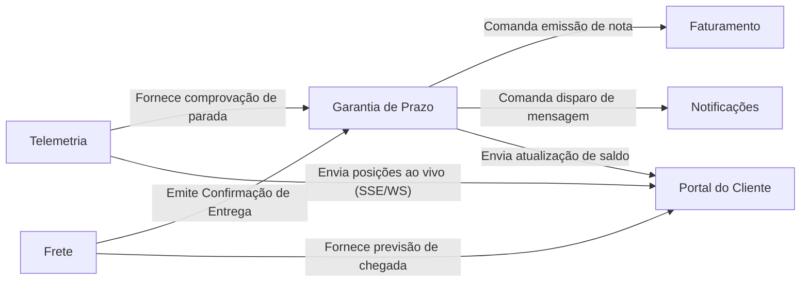

# 1. Modelagem do domínio

## Bounded contexts

<!-- Liste os contextos delimitados envolvidos na Garantia de Prazo. Cada requisito
deve ter exatamente um contexto responsável. -->

| Contexto | Responsabilidade | Requisitos sob sua responsabilidade |
|---|---|---|
| **Garantia de Prazo** | Avaliar as políticas de atraso, calcular o valor do crédito, aplicar limites (tetos) e garantir idempotência (um único crédito por pedido). | RF01, RF02, RF03, RF04, RF09, RNF02 |
| **Telemetria** | Coletar dados de GPS da frota, calcular distâncias e aferir tempo de veículo parado em raio específico. | RF05, RNF01 |
| **Frete** | Gerenciar o prazo prometido do pedido, atualizar previsões e emitir o evento oficial de confirmação de entrega. | RF01, RF10 |
| **Faturamento** | Emitir as notas de crédito transacionais, garantindo numeração sequencial e única sob alta concorrência. | RF06, RNF03 |
| **Notificações** | Gerenciar o envio de comunicados ao cliente em múltiplos canais (e-mail, WhatsApp), aplicando políticas de resiliência e retentativa. | RF07, RF08 |
| **Portal do Cliente** | Consolidar informações de diversos serviços para exibição em tempo real (mapa, saldo e previsão). | RF10 |
## Mapa de contexto

<!-- Mostre como os contextos se relacionam: quem consome dados de quem e em que
direção. Pode usar Mermaid, que o GitHub renderiza. -->

## Entidades e agregados

<!-- Para cada agregado: a raiz, as entidades e objetos de valor que ele contém e a
regra de consistência que ele protege. -->

| Agregado | Raiz | Entidades e objetos de valor | Regra que protege |
|---|---|---|---|
| **ConcessaoCredito** | `PedidoGarantia` (Entidade) | `PoliticaCliente` (Entidade), `Atraso` (Objeto de Valor), `ValorCredito` (Objeto de Valor) | O crédito não pode ultrapassar o teto da política do cliente (R$ 500 Varejo ou R$ 2.000 Corporativo) e zera se a telemetria comprovar ausência. |
| **EmissaoNota** | `NotaCredito` (Entidade) | `NumeroSequencial` (Objeto de Valor), `Valor` (Objeto de Valor) | Garante que cada crédito gere um número de nota estritamente sequencial e nunca repetido, mesmo sob concorrência. |
| **EnvioMensagem** | `Notificacao` (Entidade) | `Canal` (Objeto de Valor), `Tentativas` (Objeto de Valor) | Garante que uma falha de envio será retentada até 3 vezes e a falha final não será descartada em silêncio. |

## Linguagem ubíqua

<!-- Termos do negócio com a definição que a equipe vai usar no código. Ex.: atraso,
crédito, teto, ausência comprovada. -->

| Termo | Definição |
|---|---|
| **Atraso** | Diferença de tempo medida em horas entre o prazo originalmente prometido pelo serviço de Frete e a confirmação efetiva da entrega. |
| **Ausência Comprovada** | Condição em que o veículo fica parado a até 200 m do endereço por pelo menos 10 min antes do registro da ausência do destinatário. |
| **Teto de Crédito** | Limite máximo financeiro de compensação por pedido (R$ 500 para Varejo e R$ 2.000 para Corporativo). |
| **Cliente Cortesia** | Cliente com frete zero, que não é elegível a receber crédito financeiro por atraso, recebendo apenas notificação. |
| **Nota de Crédito** | Registro contábil gerado no Faturamento com número sequencial e único para oficializar o crédito ao cliente. |
