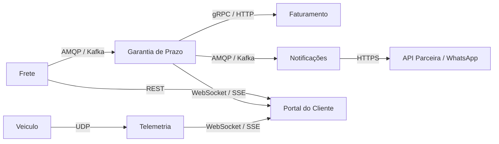

# 2. Arquitetura

## Diagrama dos serviços

<!-- Desenhe os serviços e cada comunicação entre eles. Toda seta indica o protocolo
usado (TCP, UDP, HTTP, SSE, ...). -->



## Protocolo de cada comunicação

| Origem | Destino | Protocolo | Requisito atendido | Justificativa |
|---|---|---|---|---|
| Veículo | Telemetria | UDP | RNF01 | O requisito cita que a telemetria tolera perda de pacotes. O UDP possui menor overhead, sendo ideal para envio rápido, leve e contínuo de coordenadas GPS. |
| Frete | Garantia | AMQP (RabbitMQ) | RNF01, RF09 | A confirmação de entrega não tolera perda. Uma fila de mensageria garante que a mensagem será entregue e processada, permitindo lidar com a assincronia e picos de tráfego. |
| Garantia | Notificações | AMQP (RabbitMQ) | RF08 | A mensageria permite configurar políticas de *retry* (retentativa) nativas e filas de mensagens mortas (DLQ) para reter falhas finais de envio sem descartá-las. |
| Notificações | API Externa | HTTPS | RF07 | A integração com o provedor terceiro (API da parceira de WhatsApp) via internet exige comunicação segura (TLS/SSL) e síncrona para obter o status real do disparo. |
| Telemetria / Garantia | Portal do Cliente | WebSocket (ou SSE) | RF10 | Permite comunicação bidirecional ou push unidirecional contínuo do servidor para o front-end, garantindo atualização do mapa e saldo ao vivo sem *polling*. |
| Garantia | Faturamento | gRPC / HTTP | RF06, RNF02 | Como o crédito precisa ser emitido em até 5 minutos (RNF02), uma chamada direta assegura a criação imediata e síncrona da nota de crédito no sistema. |

## Padrões de projeto

<!-- Para cada ponto da solução onde um padrão se aplica: qual padrão, qual problema
ele resolve e qual requisito motiva a escolha. -->

| Ponto da solução | Padrão | Requisito | Justificativa |
|---|---|---|---|
| Cálculo do Crédito | **Strategy** | RF02, RF03, RF04 | Encapsula as regras de cálculo (Varejo, Corporativo) em classes separadas implementando uma interface comum. Permite adicionar o novo tipo de cliente (RF04) criando uma nova classe sem alterar o código existente (Open/Closed Principle). |
| Disparo de Notificações | **Adapter / Gateway** | RF07 | A API da nova empresa parceira de WhatsApp tem formato diferente do serviço atual. O Adapter traduz a requisição interna do sistema para o contrato específico exigido por cada API externa. |
| Resiliência de Notificações | **Retry & Dead Letter Queue (DLQ)** | RF08 | Tenta processar o envio 3 vezes em caso de falha. Se esgotar as tentativas, move a mensagem para uma DLQ (Fila de Mensagens Mortas), impedindo que o erro seja descartado em silêncio. |

### Ponto onde a dupla decidiu não aplicar padrão

Optamos por não aplicar o padrão **Observer** internamente no código para a comunicação entre o serviço de Frete e a Garantia de Prazo, nem entre Telemetria e o Portal do Cliente. Em vez de acoplar os microsserviços em memória via código (como no Observer clássico), decidimos delegar essa reatividade estrutural para a infraestrutura, utilizando um *Message Broker* (RabbitMQ) e *WebSockets*. Isso garante o desacoplamento físico, resiliência a falhas e melhor escalabilidade dos contêineres.

<!-- Descreva pelo menos um lugar onde um padrão parecia cabível e a dupla optou por
não aplicar. Explique o motivo. -->

## Confirmação de entrega duplicada (RF09)

A garantia de idempotência (um único crédito gerado por entrega) fica implementada na camada de persistência (Banco de Dados) do microsserviço de **Garantia de Prazo**. 

Quando a mensagem de confirmação do Frete chega, o serviço tenta inserir um registro na tabela (ex: `creditos_concedidos`) utilizando o `id_pedido` como chave única (*Unique Constraint*). Se a mesma confirmação chegar duas vezes, a segunda tentativa de inserção gerará uma exceção de violação de restrição de unicidade no banco de dados. Essa exceção é capturada, logada e descartada com segurança pelo código, encerrando o fluxo sem efetuar um recálculo ou emitir uma nova nota.

<!-- Como a solução garante um único crédito quando a mesma confirmação chega duas
vezes? Onde essa garantia fica implementada? -->

## Numeração das notas de crédito (RF06 e RNF03)

Para garantir um número sequencial sem repetição mesmo sob 1.000 emissões concorrentes, a solução delega o controle de concorrência ao Banco de Dados do serviço de **Faturamento**, utilizando *Sequences* nativas (por exemplo, `SERIAL` ou `CREATE SEQUENCE` no PostgreSQL). 

As *sequences* operam de forma atômica e fora do controle transacional comum das tabelas. Assim, cada requisição concorrente que tenta gerar uma nota recebe imediatamente um número único incrementado (n+1) diretamente do banco, sem gerar gargalos ou depender de *locks* (bloqueios) de tabela, eliminando totalmente o risco de colisão ou números repetidos.

<!-- Como a solução garante número sequencial sem repetição sob concorrência? -->

## Execução em contêineres (RNF04)

<!-- Esboço do compose.yaml: serviços, portas e dependências. Não precisa executar. -->

```yaml
services:
  rabbitmq:
    image: rabbitmq:3-management
    ports:
      - "5672:5672"
      - "15672:15672"
  
  postgres:
    image: postgres:15
    environment:
      POSTGRES_USER: root
      POSTGRES_PASSWORD: password
      POSTGRES_DB: logitech_db
    ports:
      - "5432:5432"

  servico-garantia:
    build:
      context: ./garantia
    ports:
      - "8080:8080"
    depends_on:
      - rabbitmq
      - postgres
    environment:
      - DB_HOST=postgres
      - RABBITMQ_HOST=rabbitmq

  servico-faturamento:
    build:
      context: ./faturamento
    ports:
      - "8081:8080"
    depends_on:
      - postgres
    environment:
      - DB_HOST=postgres
```
